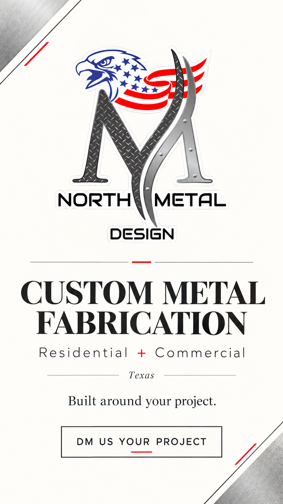
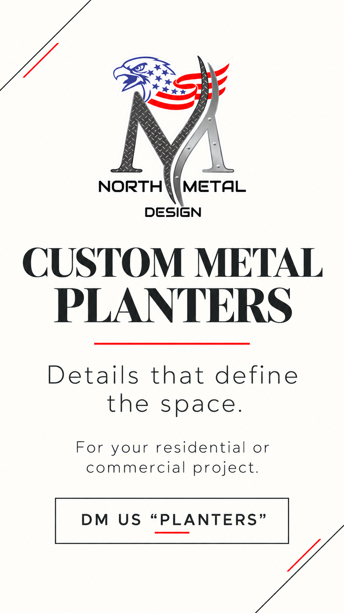
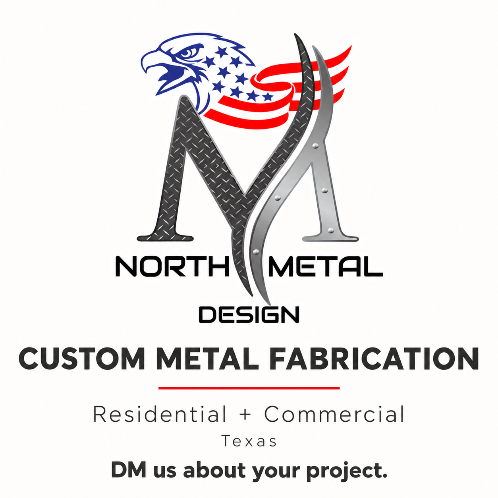

# Artes minimalistas con logo — propuestas para revisión

Instrucción vigente: **todos los artes de Stories deben incluir el logo de North Metal Design**. El cliente adjuntó el logo actual y autorizó su uso como referencia en esta conversación. Los artes comunican la empresa y sus servicios; las fotografías de trabajos mantienen el protagonismo del feed como portfolio. Videos: planificar para Reels.

## Story 1 — empresa y capacidad



Texto: Custom Metal Fabrication · Residential + Commercial · Texas · Built around your project · DM us your project.

Dimensiones del borrador: **941 × 1672**. El logo es referencia del adjunto del cliente. Verificar reproducción fiel, proporciones, contorno, detalle y texto contra el original antes de producir el archivo final. El CTA es visual; no hay botón nativo configurado.

## Story 2 — planters



Texto: Custom Metal Planters · Details that define the space · For your residential or commercial project · DM us “PLANTERS”.

Dimensiones del borrador: **941 × 1672**. Complementa una foto real del portfolio; no utiliza un producto inventado ni sustituye la fotografía del trabajo. La dirección visual de la prueba oscura fue aprobada por el cliente y se conserva como variante; ese archivo necesita logo oficial y revisión final antes de publicación.

## Post gráfico — custom fabrication



Dimensiones del borrador: **1254 × 1254**. Pieza de empresa/servicio para acompañar el portfolio, con CTA de DM. No es una exportación final 1080 × 1080.

Caption propuesto:

```text
Custom metal fabrication starts with the needs of your project. North Metal Design develops solutions for residential and commercial spaces in Texas.

DM us about your project.

#NorthMetalDesign #CustomMetalFabrication #TexasConstruction #DFWContractors #ArchitecturalMetalwork
```

## Aplicación en el calendario

Mantener al menos una foto de trabajo por día laborable en el plan. Los días de dos posts incorporan un arte minimalista adicional. Referencia del 13 de octubre al 31 de diciembre: **58 espacios de fotografías + 29 espacios gráficos = 87 posts**, sin programación realizada. Tres de los espacios gráficos se reservan para el tríptico anclado, sujeto a aprobación específica.

Los Stories complementan fotos o artes con contexto y CTA, siempre con logo. No añadir exceso de texto, listas de servicios ni hashtags que saturen la composición. Los captions IG/FB mantienen cinco hashtags específicos. Las versiones Threads se adaptan al formato verificado de la plataforma.

## Control final pendiente

- Fidelidad del logo: usar el archivo oficial original en la producción final, sin redibujar ni modificar su identidad. Estos previews generados no certifican una copia idéntica del archivo fuente.
- Formato final: exportaciones de feed 1080 × 1080 y Stories 1080 × 1920, aún pendientes.
- Revisar el tamaño del logo y reducirlo si domina la lectura en las variantes futuras; mantener espacios libres y una jerarquía simple.
- Revisar en teléfono el contraste, tamaño de letra y zonas seguras. La propuesta de Story de empresa tiene CTA bajo: ajustar su posición si interfiere con controles de la cuenta.
- Comprobar botones/enlaces nativos y destino de DM cuando exista acceso autorizado. Un recuadro gráfico no activa esa función.

Estado: **2 Stories con logo y 1 arte de feed en borrador**. Existe además una prueba oscura sin logo cuyo estilo fue aprobado; añadir el logo y validar el archivo final antes de usarla. Piezas finales, publicaciones y programación: **0**.

## Secuencia de Story confirmada

Cada arte va seguido inmediatamente por una foto del trabajo correspondiente, sin intercalar otro servicio. Registrar orden 1 arte y orden 2 foto con el mismo sequence_id. La pauta actual de Stories tiene dos bloques diarios independientes del feed: 116 bloques / 232 frames tentativos hasta fin de año, todavía sin producir ni programar. Las dos parejas de muestra están en [STORY_SEQUENCES/README.md](STORY_SEQUENCES/README.md).

## Dos líneas visuales y dos bloques diarios

Mantener las variantes oscura arquitectónica y clara minimalista, con logo en ambas. [Ver la pauta vigente](STORY_SEQUENCES/DOS_BLOQUES_DIARIOS.md).
