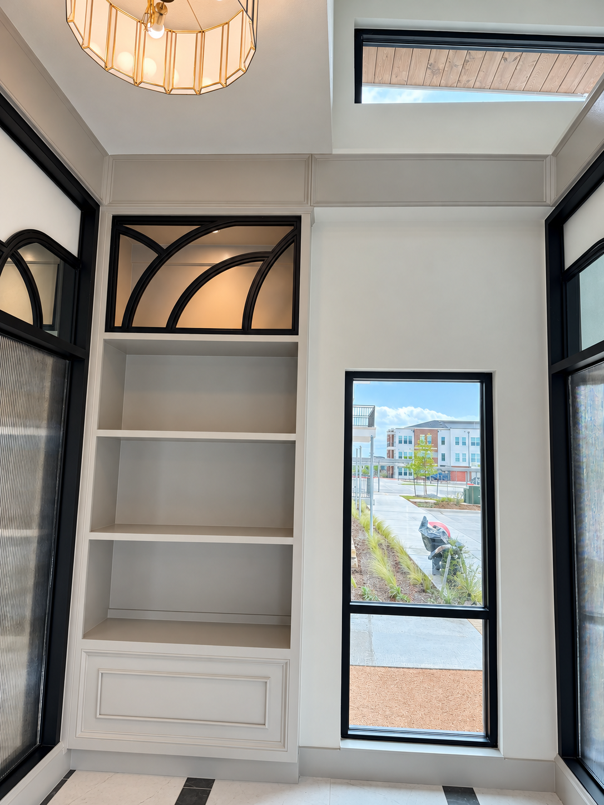
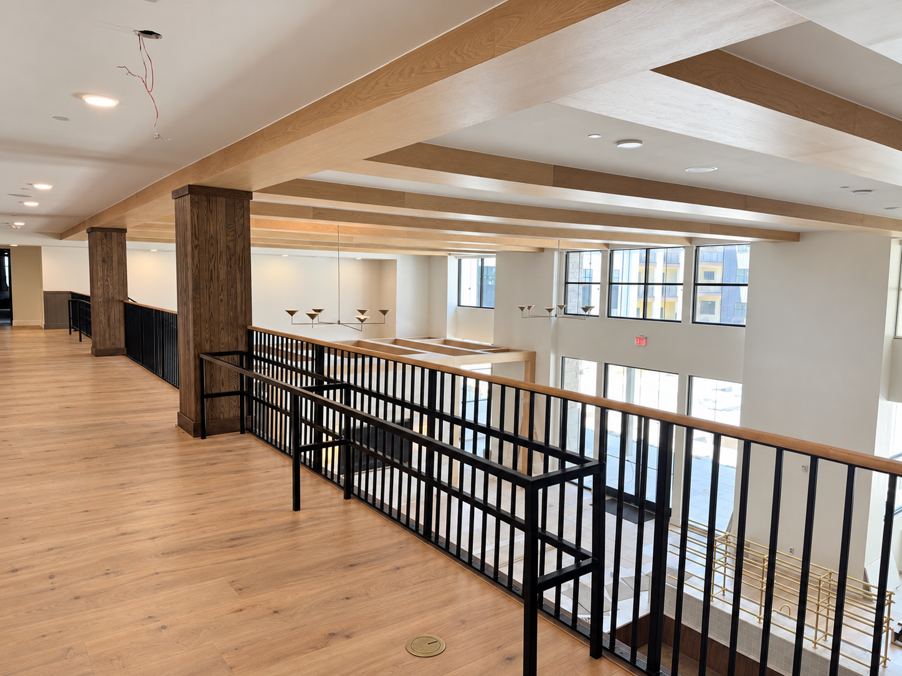

# Revisión visual — borradores, no piezas finales

El cliente exige apariencia de fotografía de revista, limpieza de elementos temporales y Stories cuidados. Las imágenes deben mostrar la fabricación real: retirar cinta, escalera o protección de piso no autoriza cambiar barras, uniones, proporciones, materiales o arquitectura del producto.

## Retoque del panel curvo

Original: `PORTFOLIO_WEB_FOR_INSTAGRAM/ORIGINALS/GALLERY/NMD_metal_screens_001.webp`. [Ver fuente original](https://northmetaldesign.com/wp-content/uploads/2025/10/4934B92B-0BCB-4C08-B516-275229CF61A1-scaled.webp).

Segunda pasada: se solicitó retirar cinta y escalera, levantar exposición y conservar el encuadre original. La primera pasada cuadrada cambió el encuadre y queda solo como prueba de dirección visual. **La fidelidad exacta de los arcos, miembros y uniones aún requiere cotejo detallado; no está aprobado para publicación.**

Dimensiones v02: **1086 × 1448**, fotografía vertical para revisión. No es una exportación 1080 × 1080.

## Retoque de barandales

Original: `PORTFOLIO_WEB_FOR_INSTAGRAM/ORIGINALS/GALLERY/NMD_railings_001.jpg`. [Ver fuente original](https://northmetaldesign.com/wp-content/uploads/2025/10/1234ADB1-30BC-4D39-8858-B7E4BE40FAB8-min-scaled.jpg).

Segunda pasada: se solicitó retirar cartón y cinta, mejorar exposición y conservar la composición horizontal. La primera pasada cuadrada cambió el encuadre y queda como prueba. La v02 conserva distracciones residuales: cables arriba y elementos de obra abajo; todavía no cumple el control final. **No está lista para publicar.**

Dimensiones v02: **1448 × 1086**. No es una exportación 1080 × 1080. No reconstruir partes del producto que no puedan verificarse en la fuente; elegir otra toma cuando la limpieza requiera inventarlas.

## Story con CTA a DM — propuesta visual

Complementa un post de planters con mensaje de diseño y una invitación a iniciar conversación. Es una composición gráfica conceptual, no una fotografía de un proyecto ni el logo oficial. La decoración de la pieza no representa un producto fabricado confirmado.

Dimensiones: **941 × 1672**, proporción aproximada 9:16. Texto principal, CTA, contraste y zonas seguras fueron revisados visualmente en el borrador. Pendientes: tamaño de exportación definitivo, logo actual cuando corresponda, revisión móvil y funcionalidad nativa de la cuenta.

El recuadro `DM US “PROJECT”` es texto gráfico. **No es un botón clicable ni una automatización configurada.** La configuración de respuesta, botón o enlace nativo debe verificarse en la plataforma y en la cuenta autorizada. No afirmar que el visitante recibirá una cotización automática.

## Revisión general de los originales

Se inspeccionaron siete hojas de contacto que representan los **79 contenidos binarios distintos**. [Inventario de calidad](quality_inventory.csv): 30 imágenes tienen observaciones prioritarias de exposición, obra temporal, encuadre o alcance de fabricación. Las demás son candidatas sin distracción evidente a escala reducida, **no aprobaciones finales**.

La revisión de miniaturas no confirma precisión del producto a resolución completa. Ningún archivo del inventario figura como listo para feed o Story.

## Control antes de marcar una pieza como lista

1. Comparar a tamaño completo con la fuente: barras, arcos, pickets, postes, uniones y proporciones.
2. Retirar elementos temporales cuando se pueda conservar fielmente el producto. Si no, usar otra toma.
3. Corregir iluminación y balance de blancos sin cambiar material, color real o textura.
4. Componer sin cortar información esencial; distinguir fotografía retocada de evidencia de obra terminada.
5. Exportar al tamaño previsto, comprobar color, enfoque y compresión.
6. Para Stories, revisar lectura rápida, zonas seguras y relación con el post; comprobar el CTA nativo cuando exista.
7. Guardar fuente, derivado, resultado del control y estado. No sobrescribir originales ni usar como evidencia real de plataforma una composición gráfica.

## Hojas de revisión general

- [Grupo 1](QA_REVIEW/group_01.png)
- [Grupo 2](QA_REVIEW/group_02.png)
- [Grupo 3](QA_REVIEW/group_03.png)
- [Grupo 4](QA_REVIEW/group_04.png)
- [Grupo 5](QA_REVIEW/group_05.png)
- [Grupo 6](QA_REVIEW/group_06.png)
- [Grupo 7](QA_REVIEW/group_07.png)
