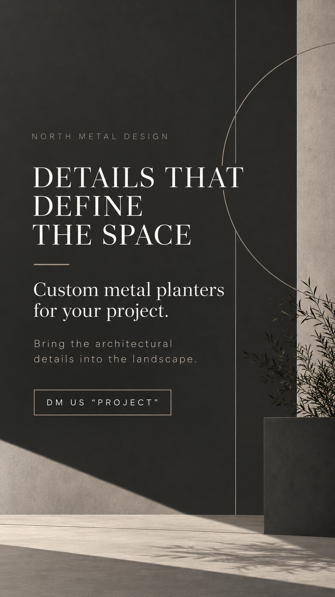

# Stories: dos bloques por día laborable

Actualización del cliente: mantener también el estilo oscuro arquitectónico mostrado en su mensaje y publicar varios Stories en dos momentos diarios. Conservar la pauta previa de lunes a viernes como referencia; los fines de semana no están añadidos.

## Cadencia y secuencia

- Bloque de mañana: **8:00 AM**, America/Chicago.
- Bloque de tarde: **1:00 PM**, America/Chicago.
- Cada bloque tiene como base **1 arte con logo → 1 foto del trabajo correspondiente**, consecutivos, sin intercalar otro servicio.
- Resultado mínimo: **4 frames por día laborable**, distribuidos en dos bloques. Añadir detalles únicamente cuando haya material distinto y útil.

La cadencia de Stories es independiente del feed: incluso en un día de un solo post, hay dos bloques de Stories. El feed sigue alternando 1 y 2 posts, con foto diaria de trabajo y gráficos complementarios en los días de dos posts. No volver a convertirlo en dos posts diarios por esta actualización.

## Volumen de referencia hasta el 31 de diciembre

Periodo tentativo del 13 de octubre al 31 de diciembre de 2026:

| Periodo | Días laborables | Bloques | Frames mínimos |
| --- | --- | --- | --- |
| 13–30 octubre | 14 | 28 | 56 |
| Noviembre | 21 | 42 | 84 |
| Diciembre | 23 | 46 | 92 |
| Total | 58 | 116 | 232 |

Esto sustituye la estimación anterior de 87 parejas / 174 frames ligados uno a uno a los posts del feed. Son **espacios de planificación**, no diseños producidos, programaciones ni publicaciones. Los horarios corresponden al bloque completo; el orden real debe comprobarse en la ruta de publicación autorizada. No programar dos frames independientes a la misma hora suponiendo que su orden se conservará.

[CSV de bloques y frames](story_blocks_resto_2026.csv): 232 filas con orden y tema propuesto. Su rotación temática es un punto de partida, no captions definitivos ni prueba de que exista un asset aprobado para cada fila. Elegir fotografías verificadas, evitar repetir la misma toma en ambos bloques de un día y distribuir el material con variedad hasta fin de año.

## Estilos aprobados como dirección visual

1. **Oscuro arquitectónico:** carbón, beige/piedra, tipografía editorial, líneas discretas y espacio libre. El cliente aprobó esta dirección visual. La versión anterior sin logo sigue necesitando el logo oficial para publicación; aprobar el estilo no sustituye el control del archivo final.
2. **Claro minimalista:** fondo claro, logo oficial en sus colores, jerarquía simple y pocos elementos. Mantenerlo como segunda línea para variar sin perder identidad.

### Referencia oscura aprobada como estilo

Esta referencia todavía no incluye el logo; es aprobación de la dirección visual, no del archivo para publicar.

Los artes de ambas líneas deben llevar el logo de North Metal Design. No redibujarlo ni recolorearlo; comprobar la reproducción contra el maestro. La composición gráfica no se presenta como foto de un trabajo realizado; la foto real viene en el frame siguiente.

## Estado real

Existen dos Stories con logo en borrador y la prueba oscura anterior cuyo **estilo** ahora está aprobado. Ninguno es todavía un archivo final publicado. Hay dos temas de parejas de muestra (Planters y empresa→puertas). No se han creado 232 piezas ni configurado botones nativos de DM.

Mantener controles de fidelidad del producto, limpieza, iluminación, dimensiones, lectura móvil, zonas seguras, logo y CTA. Cualquier reutilización de una foto debe aportar un detalle o contexto distinto; no repetir contenido únicamente para llenar la cuota.
