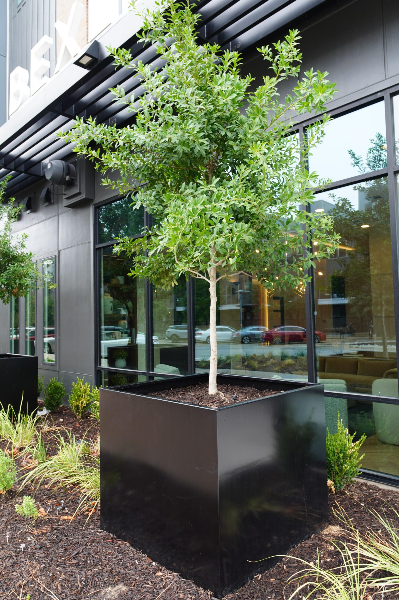
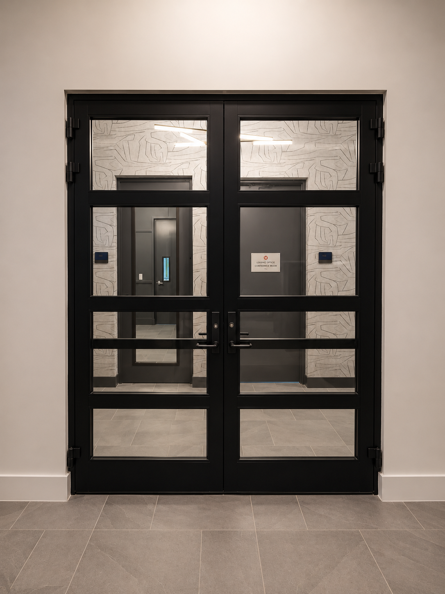

# Stories en parejas — arte y foto correspondiente

Regla confirmada por el cliente: **cada arte de Story debe ir seguido inmediatamente por una foto del trabajo que representa**. Planters → foto de un planter. Railings → foto de barandales. Doors → foto de puertas. No intercalar otro servicio o contenido dentro de la pareja.

Cada pareja se registra con un mismo `sequence_id` y dos órdenes explícitos. Son propuestas para revisión: no hay programación ni publicaciones realizadas.

## Pareja 1 — Planters

### Historia 1: arte con logo y mensaje

### Historia 2: foto de un planter del portfolio

Fuente: https://northmetaldesign.com/planters/. La copia conserva los bytes del original. Es la imagen seleccionada para el segundo frame, no una exportación final de Story. Preparar composición sin cortar el planter ni distorsionarlo y confirmar su presentación móvil antes de publicar.

## Pareja 2 — Empresa / Custom Metal Fabrication

### Historia 1: arte de empresa con logo

### Historia 2: un trabajo de puertas del portfolio

Fuente: https://northmetaldesign.com/door/. El mensaje de empresa abarca fabricación personalizada: esta segunda historia aporta un ejemplo concreto. No atribuir materiales, ubicación, cliente o ratings no confirmados. La copia es original; exportación y control final pendientes.

## Publicación y comprobación del orden

- Mantener arte → foto sin intercalar publicaciones ajenas a la secuencia.
- Comprobar en la herramienta autorizada cómo conserva el orden de los frames. No asumir que dos programaciones independientes a la misma hora se ordenan correctamente.
- Si no existe orden verificable en programación, preparar la pareja para una publicación manual controlada o una ruta soportada, y registrar la limitación.
- Después de publicar, reproducir las Stories y guardar evidencia de que el arte va seguido por la foto correcta.
- Mantener logo, legibilidad y zonas seguras en los artes. Para el frame fotográfico, conservar el producto completo y revisar la aplicación discreta de identidad sin cubrirlo.
- CTA visual y botón nativo son distintos; no se ha configurado un botón de DM.

## Volumen de planificación

Si cada uno de los 87 posts tentativos tiene esta pareja, el plan representa **87 secuencias / 174 frames de Stories para IG/FB**, pendientes de selección y producción. No son 174 diseños creados. Actualmente hay **dos parejas de muestra**, cada una con arte en borrador y foto original seleccionada. La prueba anterior sin logo no está seleccionada para publicación.

[Registro de secuencias](sequences.csv) · [Artes minimalistas](../ARTES_MINIMALISTAS.md).
