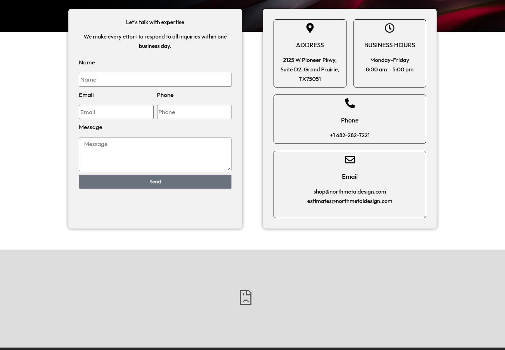
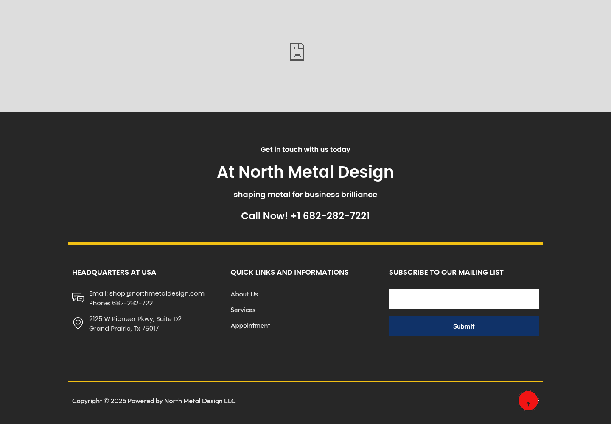
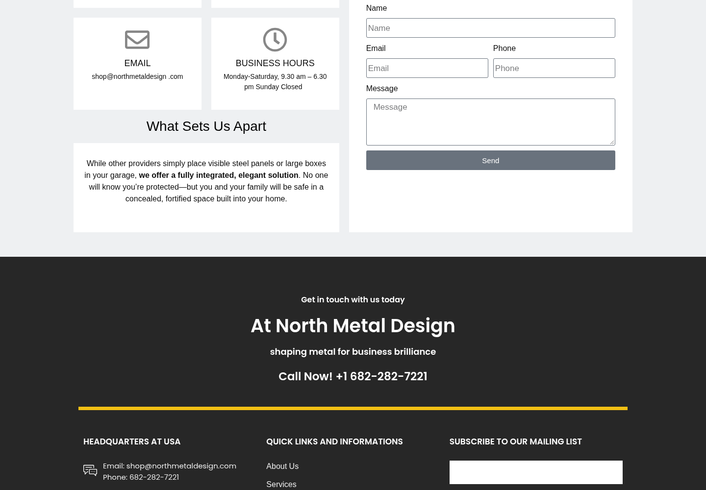
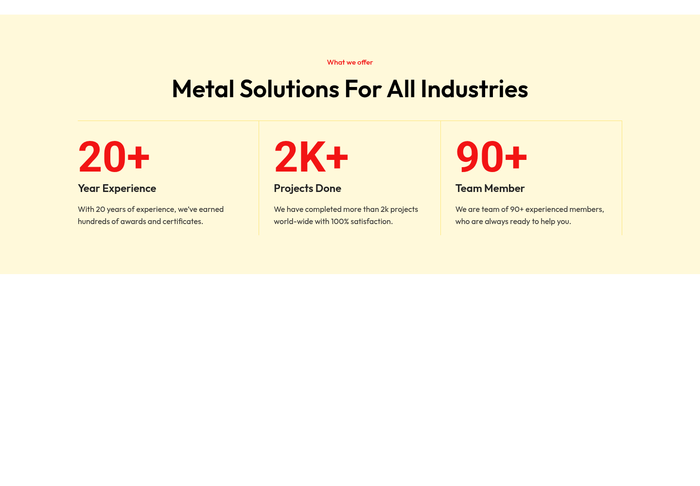

# Reporte de auditoría — North Metal Design LLC

[Auditoría detallada](public_audit_2026-10-12.md) · [Registro de evidencia](evidence_register.csv) · [Registro de trabajo](change_register.csv)

Marca prevista del reporte final: **MGT Systems**, con el logo original adjunto por el cliente, aún pendiente de incorporación. En la sección de social media se menciona colaboración con **Apsolife Media Studios LLC**.

## Evidencia del estado inicial

No se han aplicado cambios externos; estas capturas muestran el estado previo. No hay evidencia posterior de implementación.

### Contacto: ZIP 75051 y horario 8–5

### Footer: ZIP 75017 pendiente de corrección

### Safe Closet: texto de Ozlockers

### Safe Closet: horario inconsistente

### Home: cifras pendientes de respaldo

## Capturas completas

- [NMD_AUDIT_contact_BEFORE_20261012T171731Z.png](EVIDENCE/ORIGINALS/NMD_AUDIT_contact_BEFORE_20261012T171731Z.png)
- [NMD_AUDIT_home_BEFORE_20261012T171731Z.png](EVIDENCE/ORIGINALS/NMD_AUDIT_home_BEFORE_20261012T171731Z.png)
- [NMD_AUDIT_portfolio_BEFORE_20261012T171731Z.png](EVIDENCE/ORIGINALS/NMD_AUDIT_portfolio_BEFORE_20261012T171731Z.png)
- [NMD_AUDIT_safecloset_BEFORE_20261012T171731Z.png](EVIDENCE/ORIGINALS/NMD_AUDIT_safecloset_BEFORE_20261012T171731Z.png)

## Social media

Preparación editorial en colaboración con **Apsolife Media Studios LLC**. [Diez captions y conceptos de Stories](../CONTENT/first_10_drafts.md). No están programados ni publicados.

La auditoría visual integral de Meta sigue pendiente; los metadatos públicos no sustituyen esa revisión.